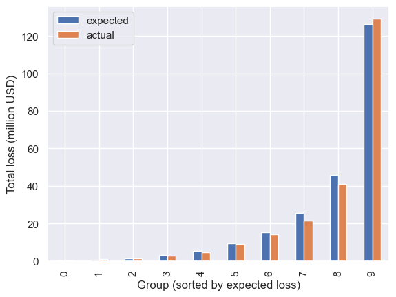

# Credit Risk: Expected Loss = PD x LGD x EAD

Personal, non-commercial learning project using the Freddie Mac Single-Family Loan-Level Dataset.
The data is not included in this repository. Download it from Freddie Mac (registration required) and place it in `data/`.

## Data

Freddie Mac Single-Family Loan-Level Dataset, sample files for the vintages 2005–2009 (50,000 loans per vintage, 250,000 in total). The performance history is available until March 2026. After removing the loans closed with codes `16` and `96`, which do not describe a clear credit outcome, 244,967 loans remain.

**Default.** `default = 1` if the loan closed with zero balance code `02`, `03`, `09` or `15` (third-party sale, short sale or charge-off, REO disposition, whole loan sale), and `default = 0` otherwise. Loans that have not closed yet (7,001) are counted as non-defaults.

The default rate is 5.7% (14,084 defaults). By vintage it rises from 5.8% (2005) to 9.3% (2007) and falls to 4.4% (2008) and 1.1% (2009), consistent with the 2007–2009 housing crisis.

## PD model

The PD model estimates the probability of default $\text{PD} = P(\text{default} = 1)$ of a loan from its characteristics at origination (notebook `02_pd_model.ipynb`).

**Split.** The loans are split randomly into a training set (195,973 loans, 80%) and a test set (48,994 loans, 20%), stratified by `default`. Everything learned from the data (bins, weights of evidence, coefficients) uses the training set only.

**Inputs.** For each category $i$ of an input, the *weight of evidence* is
$$\text{WoE}(i) = \ln \frac{n_{\text{good}}(i) / N_{\text{good}}}{n_{\text{bad}}(i) / N_{\text{bad}}},$$
and the *information value* of the input is
$$\text{IV} = \sum_i \left( \frac{n_{\text{good}}(i)}{N_{\text{good}}} - \frac{n_{\text{bad}}(i)}{N_{\text{bad}}} \right) \text{WoE}(i),$$
where good and bad mean non-default and default. Continuous inputs are first split into fine bins. Neighbouring categories are then merged (coarse classing) when they are too small or have similar WoE. Of the 22 candidate inputs, 11 are kept. Eight are dropped because $\text{IV} < 0.02$ (merging categories never increases the IV, so no grouping would change this), and three are excluded without computing their IV.

**Model.** The categories of the 11 inputs give 54 dummy variables. In each input we omit the category with the lowest WoE, the *reference category*, so the model has 43 inputs. The model is the logistic regression
$$\text{PD}(x) = \frac{1}{1 + e^{-(\beta_0 + \beta^\top x)}},$$
fitted by maximum likelihood with `statsmodels`. For each coefficient we test $H_0 : \beta_j = 0$ with the Wald statistic $z = \hat\beta_j / \text{SE}(\hat\beta_j)$, where the standard errors come from the Fisher information matrix. We apply the 5% level per original input: an input is kept if at least one of its dummies is significant. All 11 inputs passed this criterion.

### Results

On the test set the model has AUC 0.838, Gini coefficient 0.676 and KS statistic 0.521. The AUC on the training set is 0.840, so there is no sign of overfitting.

The model is also well calibrated: when the test loans are sorted by predicted PD and split into ten groups of equal size, the mean predicted PD is close to the observed default rate in every group (from 0.10% vs 0.08% in the lowest group to 26.1% vs 25.0% in the highest).

**Scorecard.** The model is converted into a scorecard with scores between 300 and 850 (a higher score means a lower probability of default). The score of a loan is the sum of the points of its categories plus the points of the intercept. The points of every category are in `outputs/scorecard.csv`. On the test set the scores range from 308 to 841, with mean 536.

## LGD and EAD models

The LGD and EAD models are fitted on the 14,084 defaulted loans (notebook `03_lgd_ead_models.ipynb`). Their estimates are conditional on default, so they can then be applied to loans that have not defaulted, to compute the expected loss.

**Targets.** The exposure is $`\text{EAD}`$ = `zero_balance_removal_upb`, the unpaid principal balance just before the loan was closed. It is measured at the end of the resolution process and not at the moment of default, which is not in the data, so it is an approximation of the balance at default. The recovery rate is

```math
\text{RR} = 1 - \frac{\text{actual\_loss}}{\text{EAD}},
```

clipped to $[0, 1]$, and $\text{LGD} = 1 - \text{RR}$. It is available for 12,986 loans (the loss is not reported for the other 1,098). The credit conversion factor is

```math
\text{CCF} = \frac{\text{EAD}}{\text{orig\_upb}}.
```

It is not clipped, since 898 loans (6.4%) have a CCF above 1.

**Split and inputs.** The defaulted loans are split according to the split of the PD model: the defaulted loans of the PD test set form the test set (2,817 loans) and the others the training set (11,267 loans). Hence every test loan is out of sample for the PD, LGD and EAD models. There are 14 candidate inputs: 7 continuous and 7 categorical, the latter converted into dummy variables, with the most frequent category as the reference category. Missing values of `credit_score` and `dti` are filled with the median of the training set, and states with fewer than 100 training loans are merged into one category, `Other`.

**LGD model.** The distribution of RR has a mass at 0 (8.0% of the loans), a mass at 1 (2.1%) and a continuous part on $(0, 1)$ (89.9%). We model the three parts separately:

1. a logistic regression for $\hat p_1 = P(\text{RR} > 0)$,
2. a logistic regression for $\hat p_2 = P(\text{RR} = 1 \mid \text{RR} > 0)$,
3. a beta regression, with a logit link for the mean, for $\hat\mu = E[\text{RR} \mid 0 < \text{RR} < 1]$, fitted by maximum likelihood.

By the law of total expectation,
$$\widehat{\text{RR}} = \hat p_1 \left[ \hat p_2 + (1 - \hat p_2)\, \hat\mu \right], \qquad \widehat{\text{LGD}} = 1 - \widehat{\text{RR}}.$$

**EAD model.** A linear regression for the CCF, fitted on all the training loans. The predicted exposure is

```math
\widehat{\text{EAD}} = \widehat{\text{CCF}} \times \text{orig\_upb}.
```

**Variable selection.** As in the PD model, a variable is kept if at least one of its dummies has a p-value below 5%. The criterion is applied to each model separately, so the models use different sets of inputs. In the second logistic regression, two dummies (`property_type:CP` and `property_state:CT`) have no loan with RR = 1, so their coefficients do not exist (quasi-complete separation); they are dropped from that model and their loans are treated like the reference category. For the EAD model, robust (HC3) standard errors give the same selection as the classical ones.

### Results

On the test set:

- **Logistic regression 1:** AUC 0.874.
- **Logistic regression 2:** AUC 0.759. Only 60 test loans have RR = 1, so this value is uncertain.
- **Beta regression:** the mean predicted RR (0.524) is close to the mean actual one (0.521), and the correlation between predicted and actual values is 0.50.
- **Combined LGD model:** on the 2,599 test loans with a reported loss, the mean predicted RR is 0.492 against 0.489 actual, and the correlation is 0.58. When the loans are sorted by predicted RR and split into ten groups of equal size, the mean predicted and actual RR differ by less than 0.02 in every group.
- **EAD model:** the mean predicted EAD (181,996 USD) is almost equal to the mean actual one (182,120 USD). The mean absolute error is 6,943 USD, against 7,416 USD for the benchmark that uses the mean CCF of the training set for every loan, a reduction of 6.4%. The model improves on the benchmark only modestly, since the EAD is determined mostly by the original balance of the loan (the correlation between the predicted and the actual CCF is 0.33).

## Expected loss

The expected loss of a loan is $\text{EL} = \text{PD} \times \widehat{\text{LGD}} \times \widehat{\text{EAD}}$ (notebook `04_expected_loss.ipynb`). It is computed for the 48,994 loans of the test set of the PD model. None of the three models was fitted on these loans, so every prediction is out of sample. The LGD and EAD models are fitted on defaulted loans only and are applied here to all loans, including those that have not defaulted, which is an extrapolation that cannot be validated with this data. The missing values of `credit_score`, `dti`, `ltv` and `num_borrowers` are filled with the medians (the most frequent value for `num_borrowers`) of the training set of the LGD and EAD models.

### Results

The total expected loss is 233.6 million USD on a total exposure of 8.64 billion USD (2.70%). The model expects 2,838 defaults against 2,817 actual ones.

The actual loss is the loss of the defaulted loans, clipped to $[0, \text{EAD}]$ like the recovery rate, and 0 for the loans that did not default. It is not reported for 218 of the 2,817 defaulted loans, so the total actual loss is not known exactly. If these loans had zero loss it would be 225.1 million USD (the expected loss is then 1.04 times the actual one), and if each defaulted loan had the mean loss of those with a reported loss, 243.9 million USD (ratio 0.96). The second value rests on an assumption that cannot be verified.

When the loans are sorted by expected loss and split into ten groups of equal size, the expected and the actual loss increase together from group to group, so the model ranks the loans correctly. The highest group contains 54% of the total expected loss, and there the expected loss is within 3% of the actual one. In the groups 2 to 8 it is between 3% and 19% above the actual loss, which is a lower bound, so we cannot tell how much of the difference is due to the missing losses.



## Limitations

**Data and default definition**
- Loans that have not closed yet (7,001) are counted as non-defaults, and the loans closed with codes `16` and `96` are removed.
- Only the vintages 2005–2009 are used (the housing crisis), with 50,000 loans per vintage, so the results may not hold for other periods.
- The models are evaluated on a random split, not on a later period, so their stability across vintages is not tested.
- The PD is the probability of default over the whole life of the loan, up to March 2026, and not the 12-month PD that is commonly used in practice.

**PD model**
- The inputs are characteristics at origination only, and the calibration is checked on the same period as the fit.

**LGD and EAD models**
- The EAD is an approximation: `zero_balance_removal_upb` is measured at the end of the resolution process and not at the moment of default. We assume that the principal does not change in between, which we have not verified.
- 6.4% of the defaulted loans have a CCF above 1. We have not verified the cause, and we do not clip the CCF.
- The recovery rate is clipped to $[0, 1]$.
- The loss is not reported for 1,098 of the 14,084 defaulted loans, and these loans are not used for the LGD model.
- The second logistic regression has only 60 events in the test set, so its AUC (0.759) is uncertain. Two dummies (`property_type:CP` and `property_state:CT`) have no events and are dropped from this model.
- The LGD and EAD models are fitted on defaulted loans only and are applied to all loans, which is an extrapolation that cannot be validated with this data.
- The variables are selected with p-values, separately for each model. In the EAD model the residuals are far from normal, and robust (HC3) standard errors give the same selection.

**Expected loss**
- The missing values of `credit_score`, `dti`, `ltv` and `num_borrowers` are filled with the median (the most frequent value for `num_borrowers`) of the training set. The `dti` is missing for about 4% of the test loans.
- The actual loss is not reported for 218 defaulted test loans, so the total actual loss is given as a range.
- There is a single random split, and no confidence intervals are computed.
